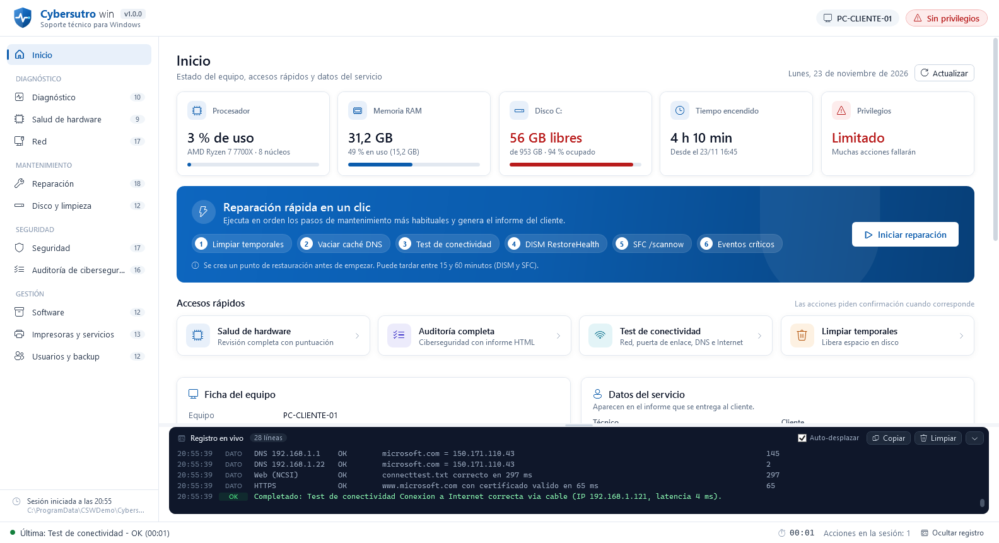
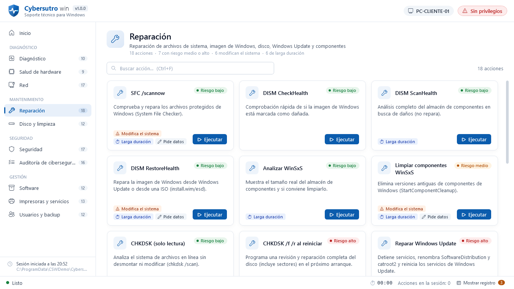
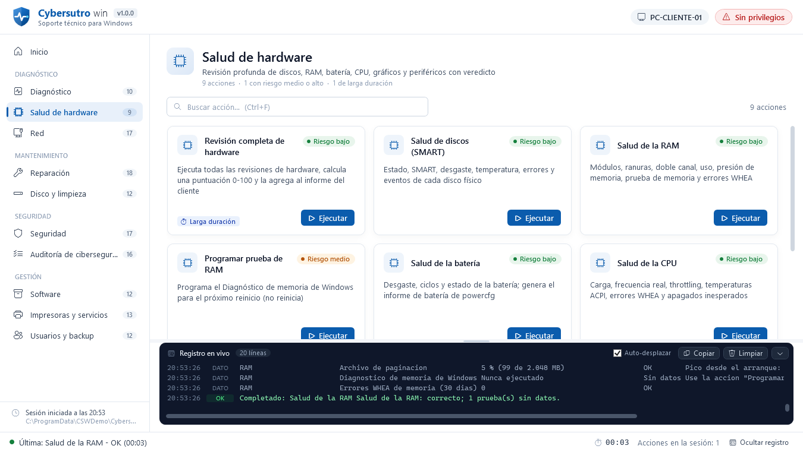
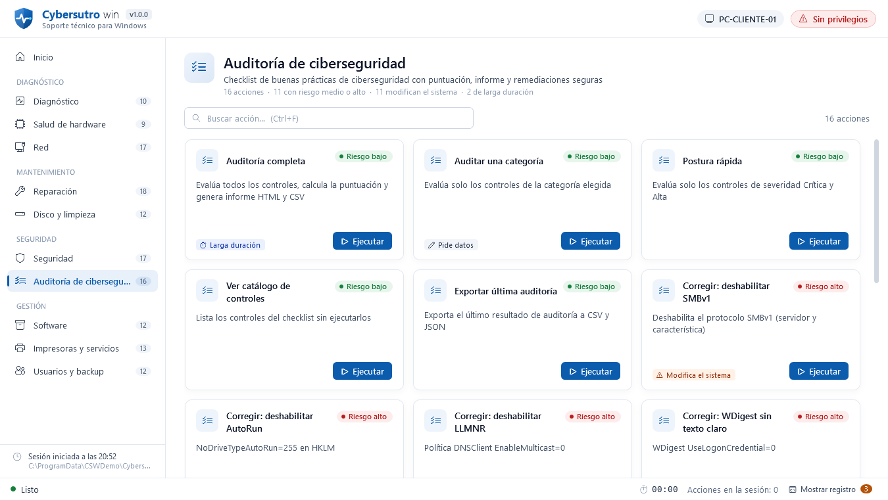
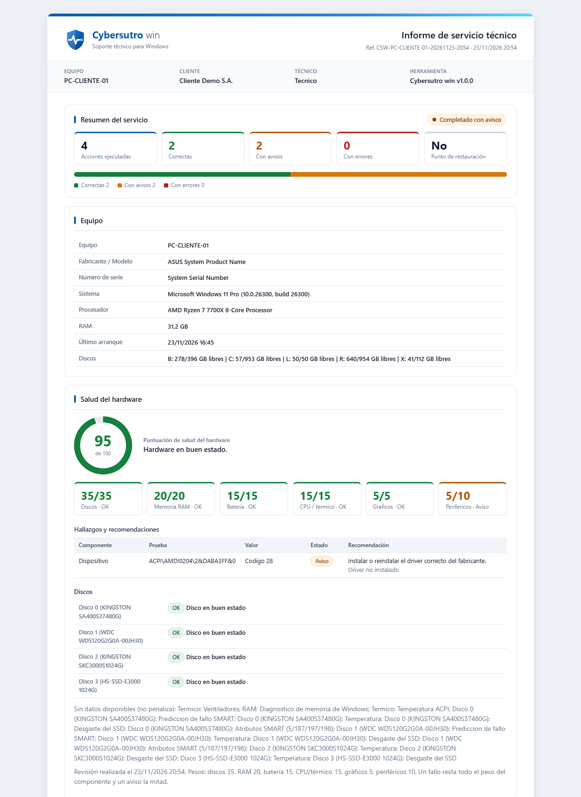

# Cybersutro win

Herramienta de **soporte técnico para Windows 10/11** escrita 100% en PowerShell.
Interfaz gráfica moderna (WPF) **y** menú de consola, pensada para técnicos que
atienden PCs de clientes: diagnostica, repara, limpia y entrega un **informe HTML
del servicio** listo para el cliente.



## Ejecutar en una línea

Abre PowerShell y pega:

```powershell
irm https://raw.githubusercontent.com/CyberSutro/cybersutro-win/main/install.ps1 | iex
```

Descarga la última versión (solo HTTPS) a una carpeta nueva con nombre aleatorio dentro de
`%LOCALAPPDATA%\CybersutroWin` (privada del usuario) y la abre como administrador.
No instala nada en el sistema.

**Descarga verificada (recomendada en equipos de clientes):** fija una versión publicada y
su SHA256. Copia el comando exacto desde las notas del
[último release](https://github.com/CyberSutro/cybersutro-win/releases/latest):

```powershell
$env:CSW_VERSION = 'v1.0.0'
$env:CSW_SHA256  = '<SHA256 publicado en el release>'
irm https://raw.githubusercontent.com/CyberSutro/cybersutro-win/main/install.ps1 | iex
```

Con `CSW_VERSION` se descarga el paquete `cybersutro-win-<version>.zip` adjunto al release;
con `CSW_SHA256` el instalador calcula su hash y **no ejecuta nada** si no coincide.

## Capturas

| Módulo con acciones | Ejecución con registro en vivo |
|---|---|
|  |  |
| **Auditoría de ciberseguridad** | **Informe HTML para el cliente** |
|  |  |

### Desde USB

Copia la carpeta y haz doble clic en `Iniciar.bat` (o `Iniciar.bat consola`).

```powershell
.\Cybersutro-Win.ps1              # interfaz grafica
.\Cybersutro-Win.ps1 -Console     # menu de consola (ideal por acceso remoto)
.\Cybersutro-Win.ps1 -QuickRepair # reparacion rapida desatendida + informe
```

## Qué incluye

| Módulo | Ejemplos |
|---|---|
| **Diagnóstico** | Resumen e inventario de hardware, software instalado, drivers con error, eventos críticos, historial de BSOD, rendimiento, programas de inicio, activación |
| **Salud de hardware** | Revisión profunda con puntuación 0-100: discos (SMART), RAM, batería, CPU/térmico, gráficos y periféricos |
| **Red** | Ping, test de conectividad completo, traceroute, flush DNS, reset Winsock/TCP-IP, test de puertos, escaneo de la red local, WiFi, proxy, test de velocidad |
| **Reparación** | SFC, DISM (Check/Scan/RestoreHealth), CHKDSK, reparar Windows Update, puntos de restauración, info de arranque, hora, reinicio pendiente |
| **Disco y limpieza** | Salud SMART, espacio, limpieza de temporales y profunda, caché de navegadores, TRIM/desfragmentación, carpetas y archivos grandes |
| **Seguridad** | Defender (estado, firmas, escaneos), firewall, puertos en escucha, autoarranques sospechosos, BitLocker, TPM/Secure Boot, protecciones activas |
| **Auditoría de ciberseguridad** | Checklist de 82 controles con puntuación 0-100 ponderada por severidad (única nota de seguridad), informe HTML/CSV y correcciones seguras |
| **Software** | winget: actualizar todo, packs de instalación, buscar/instalar/desinstalar, quitar bloatware |
| **Impresoras y servicios** | Reparar cola de impresión, Spooler, página de prueba, servicios automáticos detenidos, reparar WMI |
| **Usuarios y backup** | Usuarios locales, perfiles corruptos, backup/restauración de perfil, backup de drivers y clave de producto |

### Seguridad y trazabilidad

- **Punto de restauración automático** antes de la primera acción que modifica el sistema.
- **Confirmación** en acciones de riesgo medio/alto (con badge de riesgo visible).
- **Log completo** de cada sesión en `C:\ProgramData\CybersutroWin\Logs`. La carpeta
  `C:\ProgramData\CybersutroWin` (logs, informes y copias) queda restringida a
  Administradores y SYSTEM. Sin privilegios se usa `%LOCALAPPDATA%\CybersutroWin`.
- **Secretos**: las claves WiFi y la clave de producto completa solo se guardan en archivos
  dentro de esa carpeta protegida; nunca en el log ni en el informe del cliente.
- **Informe HTML** del servicio (equipo, acciones, resultados, log, firmas) en `...\Reports`.
- **Reparación rápida en un clic**: limpieza + DNS + conectividad + DISM + SFC + eventos + informe.

## Estructura

```
Cybersutro-Win.ps1      Lanzador (auto-elevación, STA, carga de módulos)
install.ps1             Instalador one-liner
Iniciar.bat             Doble clic desde USB
core/CSW.Core.psm1      Núcleo: registro, log, restauración, ejecución, informe
ui/CSW.Gui.ps1          Interfaz WPF (runspace en segundo plano, log en vivo)
ui/CSW.Console.ps1      Menú de consola
modules/*.psm1          Un archivo por módulo
docs/CONTRATO.md        Cómo escribir un módulo nuevo
docs/AUDITORIA.md       Auditoría de seguridad y calidad del propio código
```

## Añadir funciones

Crea `modules/MiModulo.psm1`, define tus funciones y llama a `Register-CSWModule`.
La GUI y la consola lo muestran solas. Detalles en [docs/CONTRATO.md](docs/CONTRATO.md).

## Requisitos

Windows 10/11 · Windows PowerShell 5.1 (incluido) o PowerShell 7 · permisos de administrador.

## Aviso

Herramienta para técnicos. Las acciones de riesgo medio/alto piden confirmación y se crea un
punto de restauración antes de modificar el sistema, pero úsala bajo tu responsabilidad y con
autorización del dueño del equipo.

## Licencia

[MIT](LICENSE)
